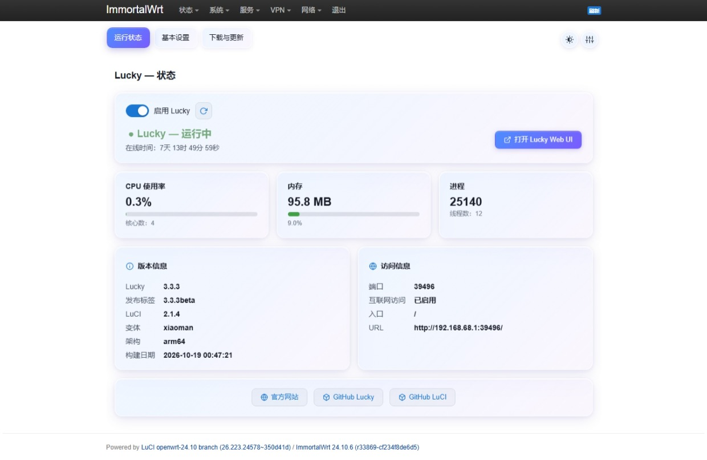
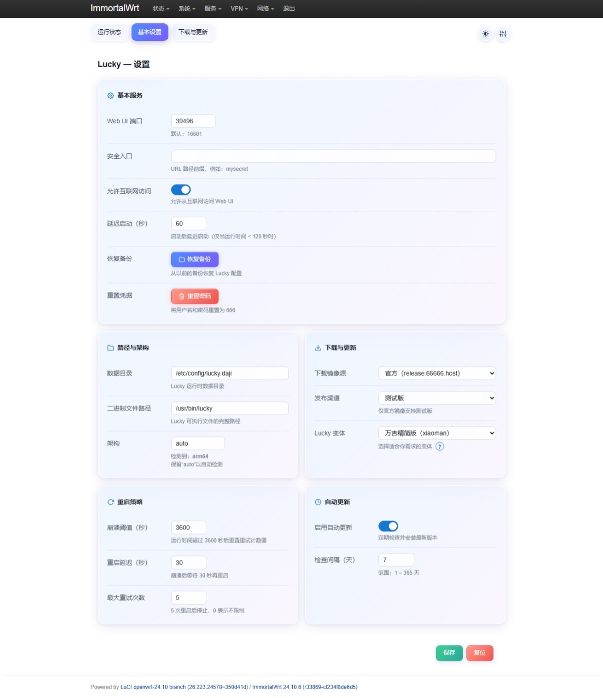
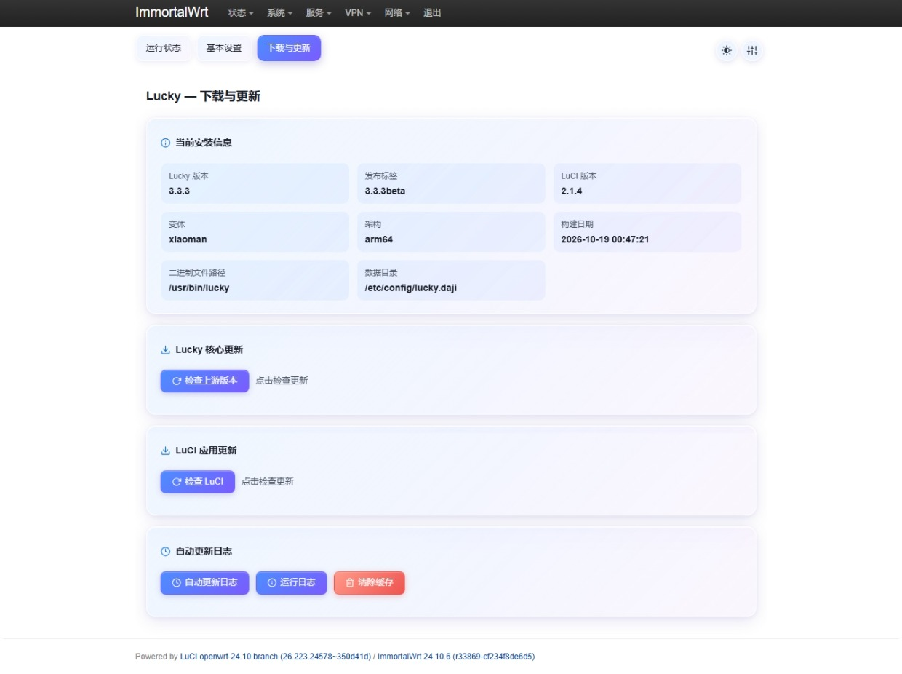

# luci-app-lucky — 稳定可靠的 Lucky 管理插件 for OpenWrt

`luci-app-lucky` 是一个为 OpenWrt 定制的 LuCI 界面插件，用于管理 [Lucky](https://github.com/gdy666/lucky) 网络工具。与同类项目相比，本插件在固件更新、进程守护、版本选择和架构适配方面做了深度优化，让 Lucky 的部署和维护更加省心。

---

## ✨ 特性亮点

- **配置持久化**  
  默认将 Lucky 数据目录设置为 `/config/lucky.daji`（而非 `/etc/lucky`），也支持手动修改。固件升级时保留配置，升级后数据不会丢失，无需手动备份。

- **进程守护**  
  集成 `Respawn` 机制。当 Lucky 主进程意外崩溃或退出时，插件会自动重新拉起进程，保证服务持续可用。

- **灵活的目录定制**  
  支持在 LuCI 界面中自定义 Lucky 数据目录和程序安装目录，满足不同存储布局需求。

- **多版本一键切换**  
  可从官方仓库（[GitHub](https://github.com/gdy666/lucky)）或官网（[https://release.66666.host](https://release.66666.host)）自动检测更新，并支持选择以下版本：
  - 标准版
  - 万吉版（wanji）
  - Beta 版
  - 基础精简版（XiaoJV）
  - 精简版 + WAF（XiaoJV WAF）
  - 万吉精简版（xiaoman）
  - Lucky Docker 版
  - Wanji Docker 版

- **智能架构适配**  
  无需手动安装对应架构的二进制包，`luci-app-lucky` 会自动下载匹配的版本。  
  > 本质上，aarch64/ARM64、A53、A55、A72 等 CPU 架构共用同一个二进制包。如果为每个架构单独编译，会浪费大量时间，因此本项目不需要单独安装架构包，而是改为自动下载。

---

## 📌 安装须知

- 本 LuCI 插件基于 **UCode（非 Lua）** 开发。
- 需要的最低 OpenWrt 版本：**OpenWrt 22.03 及以上**。
- **不兼容 QWRT（基于 OpenWrt 21.02 的系统）**。
- 使用旧版本 OpenWrt（22.02 或更早）将无法正常运行本插件。

---

## 📦 快速安装

在 OpenWrt 终端中执行以下任一命令，即可一键安装：

```bash
# 使用 curl
curl -fsSL "https://gitlab.com/whzhni/tailscale/-/raw/main/Auto_Install_Script.sh" | sh -s luci-app-lucky
```

```bash
# 使用 wget
wget -q -O - "https://gitlab.com/whzhni/tailscale/-/raw/main/Auto_Install_Script.sh" | sh -s luci-app-lucky
```

脚本会自动完成依赖检查、软件包下载和 LuCI 界面注册。安装后，可在 OpenWrt 管理页面的 **服务** 菜单中找到 **Lucky** 配置入口。

---

## ⚙️ 配置说明

安装完成后，通过 LuCI 界面进入 **Lucky** 配置页面，你可以：

- 修改 **数据存储目录**（默认 `/config/lucky.daji`）
- 修改 **程序文件目录**（默认 `/usr/bin/lucky`）
- 切换 **Lucky 版本**：
  - 标准版
  - 万吉版（wanji）
  - Beta 版
  - 基础精简版（XiaoJV）
  - 精简版 + WAF（XiaoJV WAF）
  - 万吉精简版（xiaoman）
  - Lucky Docker 版
  - Wanji Docker 版
- 开启/关闭 **自动更新**（支持从 GitHub 或官网拉取）
- 查看当前运行状态、日志以及进程守护状态

---

## 🔄 更新与维护

- **自动更新**：开启后，插件会定期检查官方源的新版本并自动升级；也可在插件页面手动检查更新。
- **手动更新**：在 LuCI 界面点击“检查更新”按钮即可。
- **进程管理**：若 Lucky 进程异常退出，`Respawn` 会在 30 秒内将其重新启动；若 1 小时内连续 5 次启动失败，则放弃启动。相关参数可在设置页面自定义。

---

## 🖼️ 界面预览

  
  

